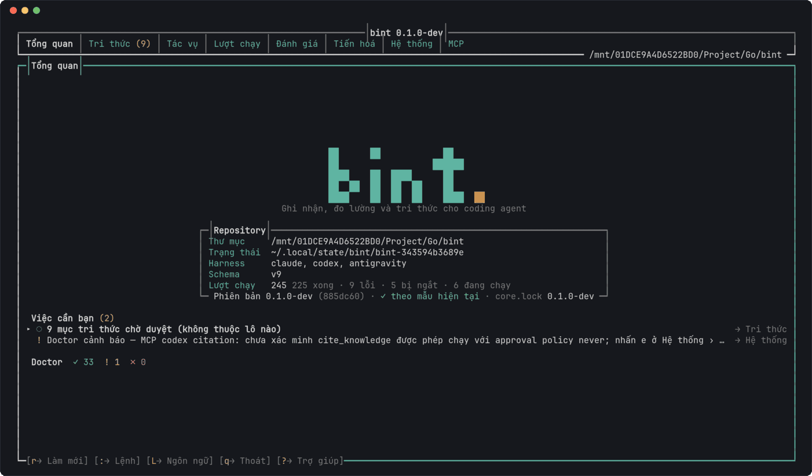
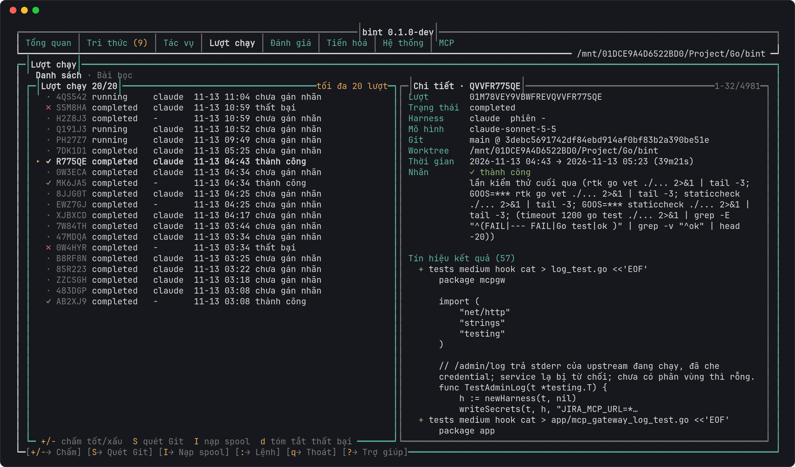
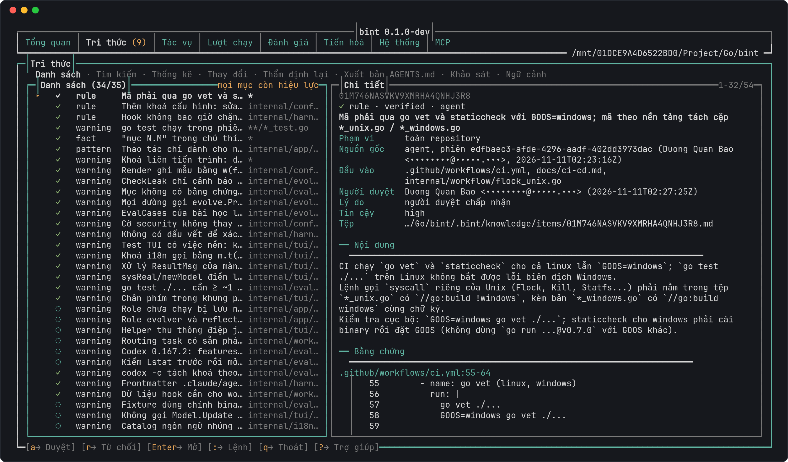
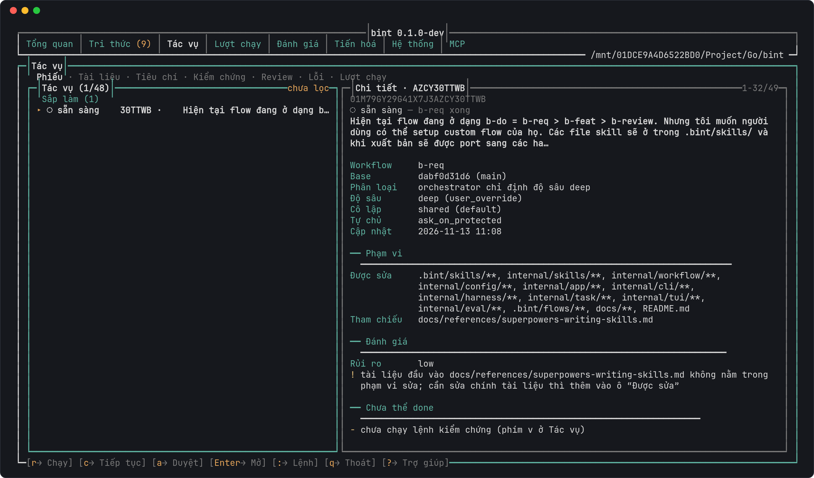
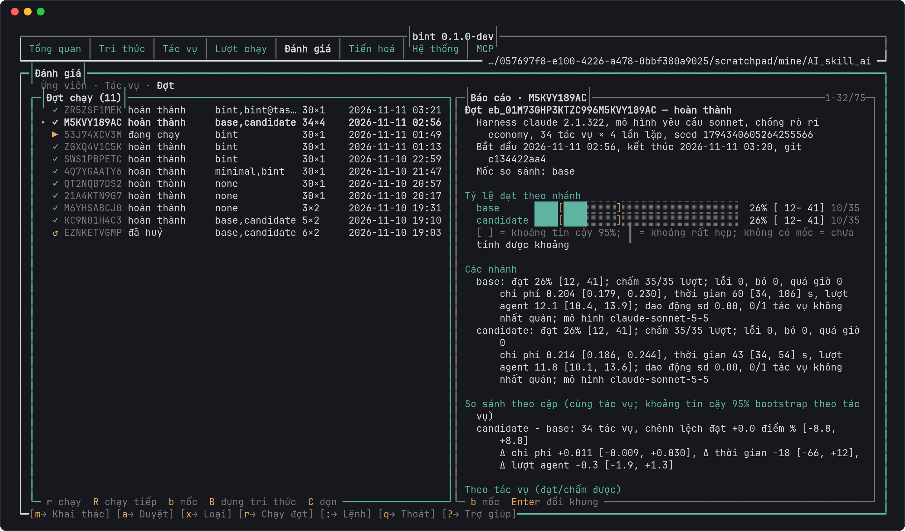
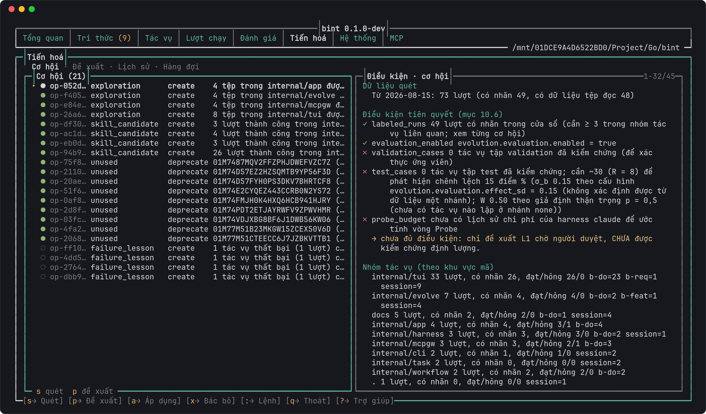
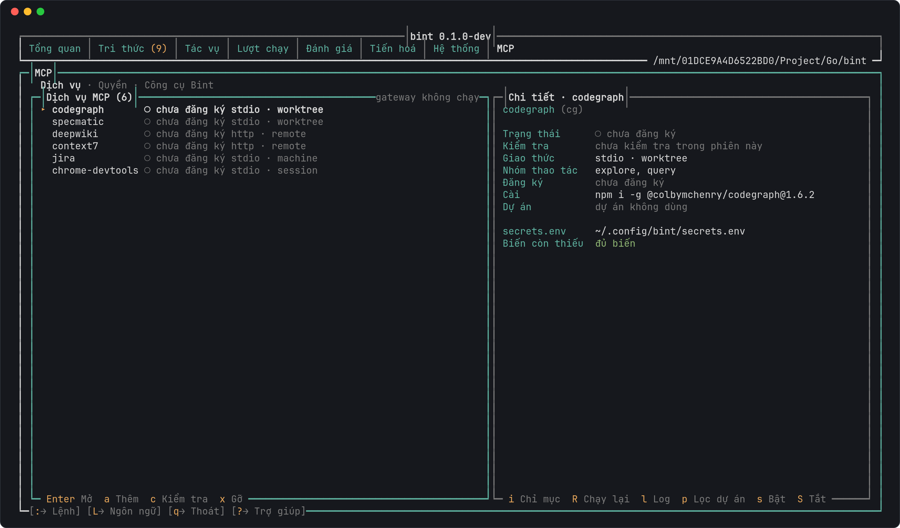
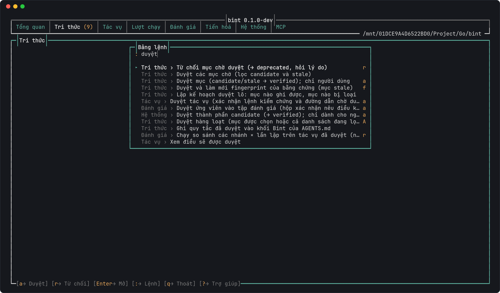

<p align="center">
    <picture>
        <source media="(prefers-color-scheme: dark)" srcset="docs/assets/logo-dark.svg">
        
    </picture>
    <br>
    <br>
    <em>"Ghi nhận, đo lường và tri thức cho coding agent."</em>
    <br>
    <br>
    <a href="https://github.com/qxbao/bint/actions/workflows/ci.yml">
        </a>
    <a href="go.mod">
        </a>
    <a href="LICENSE">
        </a>
    <br>
    
    
    <a href="docs/status.md">
        </a>
</p>

<h4 align="center">
  <a href="docs/usage.md">Hướng dẫn sử dụng</a> |
  <a href="docs/README.md">Tài liệu</a> |
  <a href="docs/bint-plan.md">Đặc tả thiết kế</a> |
  <a href="docs/status.md">Trạng thái</a>
</h4>

**Bint** là CLI và giao diện terminal chạy cạnh coding agent (Claude Code, Codex, Antigravity): ghi nhận
từng lượt chạy, giữ tri thức dự án **có bằng chứng** do người duyệt, điều phối workflow
yêu cầu → triển khai → review trên nhiều harness, đánh giá trong môi trường Git cô lập và chỉ tiến hoá
tri thức/skill khi số đo chứng minh là có ích.

## Bắt đầu nhanh

> [!TIP]
> Xem qua GIF bên dưới để biết `bint` làm được gì trước khi cài.

Cài `bint` từ mã nguồn (Go thuần, không cần CGO):

```sh
git clone https://github.com/qxbao/bint.git && cd bint
go install ./cmd/bint
```

> [!NOTE]
> Cần Go >= 1.25.1, git >= 2.31 và CLI của harness muốn dùng. Các cách build khác, biên dịch chéo và
> chi tiết `bint init`: [docs/usage.md](docs/usage.md) 📦

Khởi tạo trong repository của bạn rồi mở giao diện terminal:

```sh
cd path/to/your-repo
bint init --hooks   # cài hook ghi nhận + skill gốc cho các harness được bật
bint doctor         # kiểm tra môi trường
bint                # mở TUI
```



## Tính năng

> [!NOTE]
> Mỗi tính năng có hướng dẫn riêng trong [docs/](docs/README.md) 📚. Ảnh chụp lấy từ dữ liệu thật của chính
> repository này (Bint được phát triển bằng Bint).

### Ghi nhận lượt chạy

Hook của từng harness ghi sự kiện vào spool (không bao giờ chặn agent); Bint nạp vào SQLite và gắn nhãn
kết quả cho mỗi lượt chạy: commit, kiểm thử cuối cùng qua hay hỏng, tệp đã đọc/sửa, chi phí.
Lượt thất bại được tóm tắt thành bài học cho lần sau.

[](docs/architecture.md)

➡️ [docs/architecture.md](docs/architecture.md)

### Tri thức có bằng chứng

Quy tắc, điểm dễ sai và mẫu của dự án được lưu thành mục tri thức kèm bằng chứng `tệp:dòng` và
fingerprint. Mục do agent đề xuất ở trạng thái `candidate` cho tới khi **người** duyệt; bằng chứng đổi
thì mục bị đánh dấu `stale`. Mục đã duyệt được xuất bản vào `AGENTS.md`/`CLAUDE.md` và phục vụ qua
Context Engine (FTS5) cùng MCP server cho agent.

[](docs/knowledge.md)

➡️ [docs/knowledge.md](docs/knowledge.md)

### Workflow đa harness

`bint run b-do` điều phối Classify → `b-req` (yêu cầu, kế hoạch) → `b-feat` (triển khai) → `b-review`
(review có bằng chứng). Mỗi role chọn được harness và mô hình riêng, ví dụ Claude lập kế hoạch còn Codex
viết mã; tác vụ chạy trên cây chung hoặc worktree riêng, có phạm vi đường dẫn được sửa, tiêu chí chấp
nhận và lệnh kiểm chứng.

[](docs/workflows.md)

➡️ [docs/workflows.md](docs/workflows.md)

### Đánh giá cô lập

Khai thác tác vụ đánh giá từ lịch sử Git, kiểm chứng fail→pass, rồi chạy agent thật trên bản sao cô lập
với kiểm thử ẩn và chống rò rỉ lời giải. So sánh các nhánh (`none`, `minimal`, `bint`, biến thể `bint@…`)
bằng tỷ lệ đạt kèm khoảng tin cậy 95 %, chi phí, thời gian và số lượt agent.

[](docs/evaluation.md)

➡️ [docs/evaluation.md](docs/evaluation.md)

### Tiến hoá có kiểm chứng

Bint quét lịch sử lượt chạy để tìm cơ hội: tri thức không dùng tới, skill nên tạo, bài học từ thất bại.
Đề xuất chỉ được áp dụng sau khi đối chiếu trên tập validation/test độc lập (Probe tuần tự, dừng sớm
O'Brien–Fleming), có quay lui và kiểm tra hồi quy khi đổi mô hình.

[](docs/evolution.md)

➡️ [docs/evolution.md](docs/evolution.md)

### Gateway MCP

Một gateway MCP dùng chung cho mọi harness: danh mục service (codegraph, context7, deepwiki,
chrome-devtools…), đăng ký/kiểm tra/khởi động lại, bí mật nằm trong `secrets.env` và bảng quyền
role × service để mỗi bước workflow chỉ thấy đúng công cụ nó cần.

[](docs/workflows.md#quản-lý-mcp-bint-mcp)

➡️ [docs/workflows.md › Quản lý MCP](docs/workflows.md#quản-lý-mcp-bint-mcp)

### Giao diện terminal

Tám tab cho mọi thứ ở trên, điều khiển bằng bàn phím hoặc chuột. Bảng lệnh (`:` hoặc `Ctrl+K`) tìm mờ
trên mọi hành động của mọi màn; trợ giúp theo ngữ cảnh (`?`); tiếng Việt và tiếng Anh (`L`); chế độ
chỉ đọc (`--read-only`) và đơn sắc khi đặt `NO_COLOR`. Thao tác chỉ dành cho người (duyệt, áp dụng,
loại bỏ) bị khoá khi chạy trong phiên agent.

[](docs/usage.md#giao-diện-terminal-tui)

➡️ [docs/usage.md › Giao diện terminal](docs/usage.md#giao-diện-terminal-tui)

## Luồng làm việc

```sh
bint bootstrap                        # khảo sát tĩnh + xuất bản skill b-bootstrap
bint knowledge review                 # duyệt mục candidate → verified
bint bootstrap publish                # dựng khối quy tắc đã duyệt vào AGENTS.md
bint context "Mô tả tác vụ"            # gói ngữ cảnh (FTS5 + phạm vi + bài học)
bint run b-do "Mô tả thay đổi"         # Classify → b-req → b-feat → b-review
bint eval run --arms none --budget 20 # đánh giá trên môi trường Git cô lập
bint evolve cycle --budget 20         # đề xuất → đối chiếu validation/test → áp dụng
```

Trong phiên của harness có hỗ trợ skill, gọi trực tiếp `/b-bootstrap`, `/b-knowledge`, `/b-req`,
`/b-feat`, `/b-review`, `/b-do`. Toàn bộ lệnh, mã thoát và phím tắt: [docs/usage.md](docs/usage.md).

## Giao diện terminal (TUI)

Xem và duyệt tri thức, tác vụ, lượt chạy, đánh giá, tiến hoá và cấu hình ngay trong terminal thay cho việc
gõ lệnh. Thiết kế chi tiết: [docs/tui-plan.md](docs/tui-plan.md); hướng dẫn dùng:
[docs/usage.md](docs/usage.md#giao-diện-terminal-tui).

```sh
bint                  # không đối số: mở TUI nếu có terminal tương tác, ngược lại in trợ giúp
bint tui              # mở tường minh (lỗi nếu stdin/stdout không phải terminal)
bint tui --lang en    # ngôn ngữ giao diện: vi | en
bint tui --read-only  # chỉ xem: ẩn mọi hành động ghi
```

Khi stdin/stdout không phải terminal (đường ống, CI) hoặc đang chạy trong phiên agent, `bint` in trợ giúp
thay vì mở TUI. Gõ `bint tui` trong phiên agent vẫn mở được, nhưng thao tác chỉ dành cho người (duyệt, áp
dụng, loại bỏ) bị khoá kèm lý do.

**Tám tab**: Tổng quan, Tri thức, Tác vụ, Lượt chạy, Đánh giá, Tiến hoá, Hệ thống, MCP. Repository chưa
`bint init` thì TUI mở trình hướng dẫn khởi tạo.

**Phím toàn cục**

| Phím | Việc |
|---|---|
| `1`-`8` | chuyển thẳng tới tab (`1` Tổng quan … `7` Hệ thống, `8` MCP) |
| `[` `]` | tab trước / sau |
| `:` hoặc `Ctrl+K` | bảng lệnh: tìm mờ trên mọi hành động của mọi màn |
| `?` | trợ giúp theo ngữ cảnh |
| `!` | hộp Thông báo: nguyên văn thông báo hiện tại và 50 thông báo gần nhất |
| `L` | đổi ngôn ngữ trong phiên (vi ⇄ en) |
| `r` | làm mới ở Tổng quan (các màn khác: `Ctrl+R`) |
| `q` | thoát (còn việc nền thì hỏi trước) |

**Chuột** bật mặc định (bấm tab, thẻ phụ, hàng danh sách, phím ở chân phím); mọi thứ vẫn dùng được chỉ
bằng bàn phím. **Chế độ chỉ đọc** (`--read-only`) ẩn và từ chối mọi hành động ghi; đây là chế độ xem an
toàn tiện dụng, không phải ranh giới bảo mật. Đặt `NO_COLOR` để chuyển sang đơn sắc. **Ngôn ngữ** theo thứ
tự: `--lang` > `BINT_LANG` > `ui.language` trong cấu hình > `LC_ALL`/`LANG` > tiếng Việt.

## Trạng thái dự án

> [!WARNING]
> Bint đang trong giai đoạn thử nghiệm và chưa có bản phát hành chính thức. Các giai đoạn P0–P8 đã có
> trong mã và đã chạy thực nghiệm trên Claude Code lẫn Codex ([docs/evals](docs/evals/README.md)), nhưng
> cổng quyết định [1](docs/gate-1.md) và [2](docs/gate-2.md) chưa nghiệm thu chính thức và chưa có đề
> xuất tiến hoá nào được chứng minh cải thiện có ý nghĩa thống kê. Giới hạn còn mở: [docs/status.md](docs/status.md).

## Tài liệu

| Chủ đề | Tài liệu |
|---|---|
| Cài đặt, khởi tạo, lệnh CLI và phím tắt TUI | [docs/usage.md](docs/usage.md) |
| Kiến trúc, luồng sự kiện và lưu trữ | [docs/architecture.md](docs/architecture.md) |
| Cấu hình YAML, harness/mô hình theo role, ngân sách | [docs/configuration.md](docs/configuration.md) |
| Tri thức, Context Engine và vòng đời | [docs/knowledge.md](docs/knowledge.md) |
| Workflow, hợp đồng `b-req`, multi-harness và MCP | [docs/workflows.md](docs/workflows.md) |
| Khung đánh giá, chống rò rỉ và biến thể ngữ cảnh | [docs/evaluation.md](docs/evaluation.md) |
| Tiến hoá tri thức L1, skill L2, bài học và cycle | [docs/evolution.md](docs/evolution.md) |
| Thành phần quy trình: guidance, guardrail, script, strategy | [docs/harness-components.md](docs/harness-components.md) |
| Mục lục đầy đủ, kế hoạch và biên bản nghiệm thu | [docs/README.md](docs/README.md) |

## Phát triển

```sh
go test ./...                 # gồm kiểm thử đầu-cuối build tệp thực thi thật
go test -race ./...           # cần CGO/gcc
GOOS=windows go vet ./...     # kiểm tra biên dịch chéo Windows
```

CI chạy `gofmt`, `go mod tidy -diff`, `go vet` và `staticcheck` cho Linux lẫn Windows, `go test -race`
và build chéo 6 nền tảng trên mỗi PR/push vào `main`. Quy ước của dự án nằm trong [AGENTS.md](AGENTS.md);
cách chạy cục bộ và quy trình phát hành: [docs/ci-cd.md](docs/ci-cd.md).

## Giấy phép

Phát hành theo [Apache License 2.0](LICENSE).

## Bản quyền

Copyright © 2026, [Duong Quan Bao](https://github.com/qxbao)
